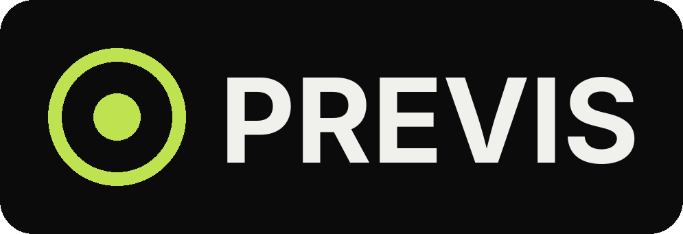
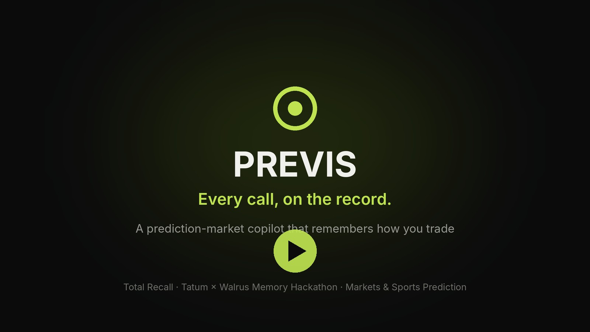
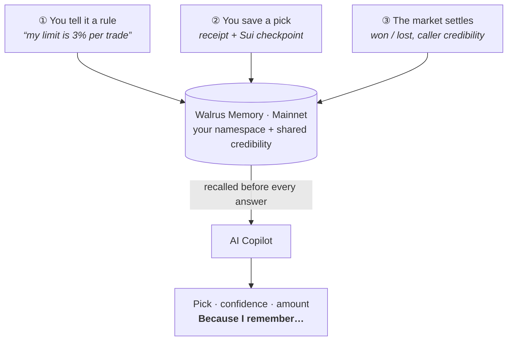
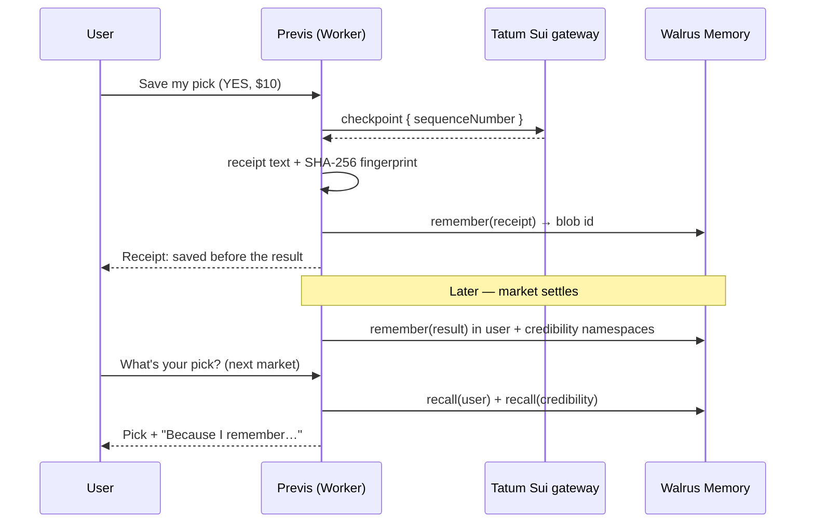
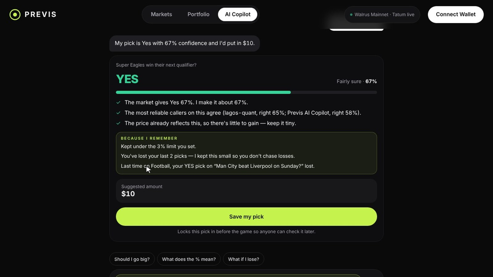
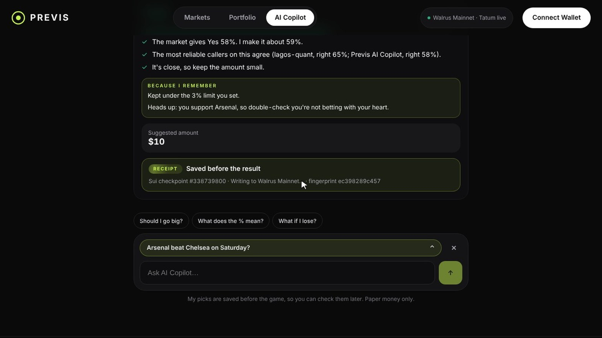
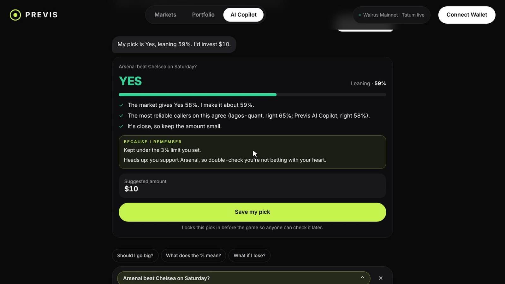
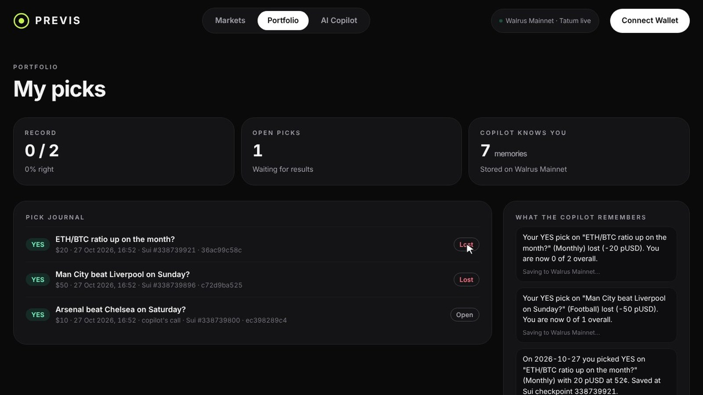
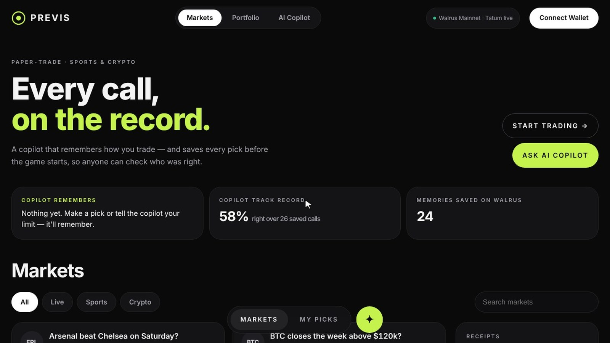
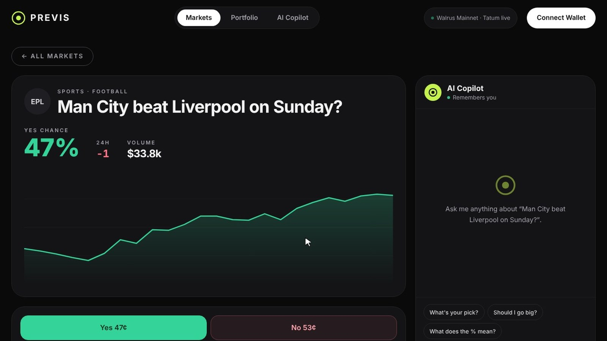

<div align="center">



<br /><br />

**Every call, on the record.**

*A prediction-market copilot that remembers how you trade — and proves every pick was made before the result.*

<p>
  <a href="https://previs.ahmardchain.workers.dev">
    
  </a>
  <a href="https://youtu.be/YsVcd4Fa34c">
    
  </a>
  <a href="https://x.com/ahmardchain">
    
  </a>
</p>

<p>
  
  
  
  
  
  
  
</p>

**Total Recall — Tatum × Walrus Memory Hackathon** · Track 01: *Markets & Sports Prediction*

</div>

---

## Welcome to Previs

> *Most prediction apps forget you the second you close the tab. Previs doesn't.*

Previs is a paper-trading prediction market for **sports and crypto** with an **AI Copilot that has a memory**. Tell it your rules, make picks, watch results come in — and every one of those becomes a memory on **Walrus Mainnet** that changes the next piece of advice it gives you.

Every pick is also a **receipt**: written to Walrus *before* the event and stamped with the current **Sui checkpoint, read live through Tatum's Sui gateway**. Callers — including the copilot itself — are ranked only on picks they can prove they made in advance.

**Remember. Advise. Prove.**

---

## Demo

<div align="center">

[](https://youtu.be/YsVcd4Fa34c)

**[▶ Watch the demo on YouTube](https://youtu.be/YsVcd4Fa34c)** &nbsp;·&nbsp; 𝕏 **[Launch post on X](https://x.com/Ahmardchain/status/2115117118614069404)** &nbsp;·&nbsp; 🌐 **Live: [previs.ahmardchain.workers.dev](https://previs.ahmardchain.workers.dev)**

</div>

<details>
<summary><b>Try it yourself in 60 seconds</b></summary>

1. Open **AI Copilot** and type `My limit is 3% per trade`, then `I support Arsenal` — both show **✓ Remembered**.
2. Choose **Arsenal beat Chelsea on Saturday?** and ask `What's your pick?` — the **Because I remember** box cites your limit and warns you're backing your own team.
3. **Save my pick** — a receipt appears with the Sui checkpoint and a fingerprint.
4. Open any market, buy Yes with paper money — *Placed, saved at Sui checkpoint #…*
5. **Portfolio → Demo · settle a market** — settle two of your picks as losses.
6. Back in the copilot, ask about **Super Eagles win their next qualifier?** — it now knows you've lost twice, keeps the bet small, and recalls your last football result.

</details>

---

## Table of Contents

- [The Problem](#the-problem)
- [Core Features](#core-features)
- [How Walrus Memory Is Used](#how-walrus-memory-is-used)
- [How Tatum Is Used](#how-tatum-is-used)
- [Platform Architecture](#platform-architecture)
- [Screenshots](#screenshots)
- [Hackathon Criteria](#hackathon-criteria)
- [Tech Stack](#tech-stack)
- [Getting Started](#getting-started)
- [Environment Variables](#environment-variables)
- [API Reference](#api-reference)
- [Project Structure](#project-structure)
- [Roadmap](#roadmap)
- [Builder](#builder)

---

## The Problem

- **Advice tools have amnesia.** Every chat starts from zero. The bot that told you to go big yesterday doesn't know you lost twice since, that you never risk more than 3%, or that you always overrate your own team.
- **Track records are unverifiable.** Every tipster "called it". Screenshots get cropped, posts get deleted, losing calls disappear. There is no cheap way to prove a call was made *before* the result.

Previs fixes both with one primitive: **a durable, verifiable memory** of what you said, what you picked, and how it turned out.

---

## Core Features

### 🧠 An AI Copilot that remembers you
Pick any market and ask. You get one clear pick (Yes/No), a confidence label, short reasons, and a suggested amount. Underneath sits a **"Because I remember"** box listing exactly which memories changed the answer:

| You told it / it saw | What changes |
|---|---|
| *"My limit is 3% per trade"* | Every suggested amount is capped at your limit — and it tells you so |
| *"I support Arsenal"* | Backing your own team triggers a heart-over-head warning |
| Two losses in a row | Size is cut so you don't chase losses |
| A past result in the same league | It reminds you how your last pick there went |
| A connected Sui wallet | It notes how experienced you are on-chain and explains more simply if you're new |

The numbers always come from Previs's own rules. **Cloudflare Workers AI** (Llama 3.1 8B) only rephrases the reply — any rewrite that changes a number is thrown away.

### 🧾 Receipts — proof the pick came first
Saving a pick writes it to Walrus Memory **before the event** and stamps it with the **latest Sui checkpoint** (via Tatum) plus a **SHA-256 fingerprint** of the receipt text. The journal shows the checkpoint and fingerprint for every pick, so it can't be quietly edited later.

### 🏆 Who to trust — a leaderboard you can't fake
Every caller, including *Previs AI Copilot* itself, is graded **only on picks saved before the result**. Credibility is a smoothed hit-rate, `(wins + 2) / (total + 4)`, so a lucky 2-for-2 doesn't outrank a proven 13-for-20. When the copilot gives advice, it weights each caller's view by that score.

### 🔁 Learning from results
When a market settles, Previs grades every open pick and writes the outcome to memory twice — to the **player's own namespace** ("your YES pick on … lost") and to a **shared credibility namespace** ("lagos-quant called NO on … and was right, now 13 of 20"). The next answer is different because of it.

### 📒 Pick journal & portfolio
Your record, open picks with their receipts, and **everything the copilot remembers about you**, each with its Walrus blob id.

### 📈 Markets
Eight paper-money markets across football, basketball and crypto, with YES price history, 24h move and volume, a trade ticket with quick amounts, and the copilot docked beside every market.

---

## How Walrus Memory Is Used

Walrus Memory is the product, not a log. It's read before **every** copilot answer and written on every meaningful event.

| Namespace | What's written | When | How it's used |
|---|---|---|---|
| `previs-u-<sha256>` *(one per user)* | Risk limit, teams you support, wallet experience, every pick (the receipt), every result | You tell the copilot a fact · you save/place a pick · a market settles · you connect a wallet | Recalled before each answer to size the bet and write the *Because I remember* lines |
| `previs-credibility` *(shared)* | `"<caller> called YES on … and was right. Now right 15 of 27."` | A market settles | Recalled to decide whose calls to trust on that league |



**Engineering notes**
- Writes are **asynchronous** (`remember` → blob id resolved later), so saving a pick takes about a second instead of ~28s with `rememberAndWait`.
- Walrus indexes in the background, so Previs merges memories written in the last few minutes, plus facts the browser just saw confirmed, into every recall. A fact you state is used on the very next question.
- Memory text is stored in plain, human-readable sentences, so the journal can show exactly what the copilot knows.

Code: [`src/lib/memory.ts`](src/lib/memory.ts) · [`src/lib/copilot.ts`](src/lib/copilot.ts) · [`src/app/api/resolve/route.ts`](src/app/api/resolve/route.ts)

---

## How Tatum Is Used

Sui has deprecated JSON-RPC, so Previs queries **Tatum's Sui Mainnet gateway over GraphQL** (`https://sui-mainnet.gateway.tatum.io/graphql`, `x-api-key` header).

| Query | Purpose |
|---|---|
| `checkpoint { sequenceNumber }` | Stamps every receipt with the latest Sui checkpoint at save time — proof the pick came first (cached 5s to respect rate limits) |
| `address { balance(coinType: "0x2::sui::SUI") }` | Reads a connected wallet's SUI balance |
| `transactions(last: 20, filter: { sentAddress })` | Gauges on-chain experience; stored as a memory so the copilot adapts its explanations |

Code: [`src/lib/sui.ts`](src/lib/sui.ts)

---

## Platform Architecture

```
+-------------------------------------------------------------------+
|                 previs.ahmardchain.workers.dev                    |
|          Next.js 16 App Router on Cloudflare Workers (OpenNext)   |
+------------------+-------------------------+----------------------+
|    Frontend      |       API Routes        |   Copilot engine     |
|  Markets         |  /api/copilot           |  rules: sizing,      |
|  Market view     |  /api/picks             |  limits, streaks,    |
|  AI Copilot      |  /api/resolve           |  team bias, lessons  |
|  Portfolio       |  /api/leaderboard       |  + Workers AI        |
|                  |  /api/memory  /wallet   |    phrasing only     |
+------------------+------------+------------+----------------------+
                                |
        +-----------------------+------------------------+
        |                       |                        |
 Walrus Memory (Mainnet)  Tatum Sui gateway       Cloudflare KV
 - per-user namespace     (GraphQL, Mainnet)      - picks & callers
 - credibility namespace  - checkpoints           - settlements
 - remember / recall      - wallet balance/txs    - memory mirror
```

### Data flow — saving a pick



---

## Screenshots

| Memory changes the advice | Receipt saved before the result |
|---|---|
|  |  |
| **Because I remember — your limit and your team** | **Pick journal & memories on Walrus** |
|  |  |
| **Home** | **Market view with docked copilot** |
|  |  |

---

## Hackathon Criteria

| Requirement | How Previs meets it |
|---|---|
| Walrus Memory integrated, writing on **Mainnet** | `MEMWAL_SERVER_URL=https://relayer.memory.walrus.xyz`; every fact, pick and result is a Mainnet memory with a blob id shown in the app |
| Memory that matters, not storage for its own sake | Recalled before every answer; the *Because I remember* box shows the exact memories that changed the pick and the amount |
| Tatum for on-chain data | Sui checkpoints on every receipt; wallet balance and activity via Tatum's Sui GraphQL gateway |
| 10+ memories on Mainnet | The demo flow alone writes 10+; the live app has written dozens (see `/api/status`) |
| Working demo + public repo | Live on Cloudflare Workers; this repo; [demo video](https://youtu.be/YsVcd4Fa34c) |
| Track 01 — Markets & Sports Prediction | Sports and crypto markets, a copilot that learns from your results, and a provable caller leaderboard |

---

## Tech Stack

| Layer | Technology |
|---|---|
| **Framework** | Next.js 16 (App Router), React 19 |
| **Language** | TypeScript 5 |
| **Styling** | Hand-written CSS design tokens, Sora + Inter |
| **Memory** | Walrus Memory SDK `@mysten-incubation/memwal` (Mainnet relayer) |
| **On-chain data** | Tatum Sui Mainnet gateway (GraphQL) |
| **AI** | Cloudflare Workers AI — `@cf/meta/llama-3.1-8b-instruct-fast` (phrasing only, 6s cap) |
| **Hosting** | Cloudflare Workers via `@opennextjs/cloudflare` |
| **State** | Cloudflare KV (picks, callers, settlements, memory mirror) |
| **CI/CD** | Cloudflare Workers Builds — every push to `main` deploys |

---

## Getting Started

### Prerequisites

- Node.js 20+
- A Walrus Memory key and account id ([memory.walrus.xyz](https://memory.walrus.xyz))
- A Tatum API key with Sui Mainnet access ([dashboard.tatum.io](https://dashboard.tatum.io))

### Installation

```bash
git clone https://github.com/ahmardchain/previs.git
cd previs
npm install
cp .env.example .env.local      # add MEMWAL_KEY, MEMWAL_ACCOUNT_ID, TATUM_API_KEY
npm run check-keys              # confirms both keys work and writes 1 memory
npm run dev
```

Open [http://localhost:3000](http://localhost:3000). Without keys the app still runs in **demo mode** (memories go to a local file, no checkpoints); the header pill shows which mode is live.

### Deploy to Cloudflare Workers

**Dashboard (auto-deploys on every push):** Workers & Pages → Create → Import a repository → `previs`
- Build command: `npx opennextjs-cloudflare build`
- Deploy command: `npx wrangler deploy`
- Settings → Variables and Secrets → add `MEMWAL_KEY`, `MEMWAL_ACCOUNT_ID`, `TATUM_API_KEY` as **secrets**

**CLI:** `npx wrangler login`, then `npm run deploy`. Add secrets with `npx wrangler secret put MEMWAL_KEY` (repeat for each).

The KV namespace (`PREVIS_KV`) and Workers AI binding (`AI`) are declared in [`wrangler.jsonc`](wrangler.jsonc).

---

## Environment Variables

Copy `.env.example` to `.env.local`. Never commit real credentials.

### Required

| Variable | Description |
|---|---|
| `MEMWAL_KEY` | Walrus Memory API key |
| `MEMWAL_ACCOUNT_ID` | Walrus Memory account id (Sui) |
| `MEMWAL_SERVER_URL` | Relayer URL — `https://relayer.memory.walrus.xyz` for Mainnet |
| `MEMWAL_NAMESPACE` | Namespace prefix (default `previs`) |
| `TATUM_API_KEY` | Tatum key with Sui Mainnet access |
| `TATUM_SUI_GRAPHQL` | Tatum Sui GraphQL endpoint |

### Optional

| Variable | Description |
|---|---|
| `WORKERS_AI_MODEL` | Override the Workers AI model used for phrasing |
| `ANTHROPIC_API_KEY` / `ANTHROPIC_MODEL` | Fallback phrasing model when Workers AI isn't available |
| `PREVIS_ADMIN_KEY` | Protects the demo settle endpoint |

---

## API Reference

| Method | Route | Description |
|---|---|---|
| `GET` | `/api/status` | Live mode: Walrus network, Tatum status, latest checkpoint, memories written |
| `GET` | `/api/markets` | All markets with price history |
| `POST` | `/api/copilot` | Ask the copilot — returns pick, reasons, *because* lines, amount |
| `GET` / `POST` | `/api/picks` | List a user's picks / save a pick (receipt + checkpoint + fingerprint) |
| `POST` | `/api/resolve` | Demo: settle a market and write results to memory |
| `GET` | `/api/leaderboard` | Callers ranked by credibility |
| `GET` | `/api/memory` | What Previs remembers about a user (with Walrus blob ids) |
| `GET` | `/api/wallet` | Sui wallet snapshot via Tatum, saved as a memory |

---

## Project Structure

```
previs/
+-- src/
|   +-- app/
|   |   +-- page.tsx              # Home: markets, Who to trust, receipts
|   |   +-- copilot/              # Full-page AI Copilot
|   |   +-- market/[id]/          # Market view, chart, trade ticket, docked copilot
|   |   +-- portfolio/            # Pick journal, memories, demo settlement
|   |   +-- api/
|   |       +-- copilot/          # Ask the copilot
|   |       +-- picks/            # Save picks as receipts
|   |       +-- resolve/          # Settle markets -> results become memories
|   |       +-- leaderboard/      # Credibility rankings
|   |       +-- memory/           # Per-user memories
|   |       +-- wallet/           # Sui wallet via Tatum
|   |       +-- status/           # Live/demo status
|   +-- components/               # Header, Footer, MarketCard, CopilotChat, UserProvider
|   +-- lib/
|       +-- copilot.ts            # Advice engine: sizing, memory rules, AI phrasing
|       +-- memory.ts             # Walrus Memory remember / recall
|       +-- sui.ts                # Tatum Sui GraphQL gateway
|       +-- store.ts              # Picks, callers, settlements (Cloudflare KV)
|       +-- markets.ts            # Demo markets
+-- scripts/check-keys.mjs        # Verifies Walrus + Tatum keys
+-- docs/                         # Logo, screenshots, demo video
+-- wrangler.jsonc                # Workers, KV and AI bindings
```

---

## Roadmap

- **Live odds & results feeds** — replace demo markets and manual settlement with sports/crypto data and an oracle.
- **Sources disagree flag** — compare bookmaker odds with on-chain markets and warn when they diverge.
- **On-chain receipts** — anchor the receipt fingerprint in a Sui transaction, not just a checkpoint reference.
- **Agent payments (x402)** — let other agents pay to query the credibility memory.
- **Shareable caller profiles** — a public, verifiable track record per wallet.

---

## Builder

Built by **Ahmad (AHMARD)** for the Total Recall hackathon.

| | |
|---|---|
| X | [@ahmardchain](https://x.com/ahmardchain) · [launch post](https://x.com/Ahmardchain/status/2115117118614069404) |
| Telegram | [@ahmardchain](https://t.me/ahmardchain) |
| GitHub | [ahmardchain](https://github.com/ahmardchain) |

---

<div align="center">


<br />

*Paper money only. Markets and odds are demo data. Not financial advice.*

*Built on Walrus Memory and Tatum. Every call, on the record.*

</div>
